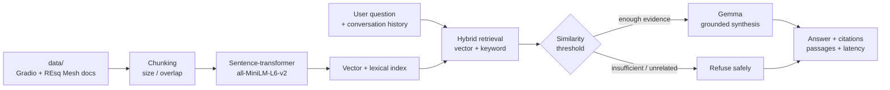

# Open-Source Contributor Guide

RAG Application with Gemma — Problem 2B

This project turns contributor documentation into a grounded question-answering guide. It combines Gradio's contributor docs with the REsq Mesh project README, retrieves relevant passages, answers with Gemma, and exposes the source files and passages used for each answer.

## Problem

New open-source contributors spend time searching across setup instructions, testing commands, pull-request conventions, community standards, and project-specific documentation. A generic chatbot can answer fluently while inventing a command or policy. This application is designed to answer only from the indexed guide and to refuse unrelated questions.

## Architecture



The evaluation track is intentionally separate from `rag.py` and `app.py`, which are owned by Laptop A. `eval/stub_rag.py` is only a temporary import-compatible stub while those files are absent.

## Pipeline

1. `build_index()` reads the documents under `data/`, splits them into overlapping chunks, and builds the retrieval structures.
2. A question is searched with hybrid lexical and embedding retrieval.
3. A threshold gate decides whether there is enough relevant evidence to answer.
4. Gemma receives the question and retrieved passages; it is instructed to stay within those passages.
5. The response includes `answer`, source file/chunk citations, passages with scores, `refused`, and `latency_s`.
6. `eval/run_eval.py` measures answer correctness with a Gemma judge, source citation hit, refusal accuracy, and latency.

## Design decisions and evidence

| Decision | Why it is in the design | Evidence status |
|---|---|---|
| Hybrid retrieval | Contributor questions often contain exact commands such as `run_backend_tests.sh`, while semantic retrieval helps with paraphrases. | The experiment runner compares hybrid on/off one factor at a time; final numbers are pending Laptop A's `rag.py` and Gemma credentials. |
| Default `chunk_size=800`, `overlap=120` | A moderate chunk keeps a section coherent while preserving nearby context. | The runner compares 400 and 1200 against this anchor; no result is claimed before a real run. |
| `top_k=4` and threshold `0.30` | Four passages provide context without flooding the synthesis prompt; the threshold is explicit and tunable. | The runner compares `top_k` 2/6 and thresholds 0.20/0.40. |
| Refusal is a first-class result | Out-of-scope prompts are part of the test set, not an afterthought. | Five out-of-scope cases are scored separately. |
| LLM judge plus citation hit | A citation can be present while the synthesis is wrong, and a correct answer can miss its expected source. | `eval/run_eval.py` reports both dimensions instead of collapsing them. |

## Run it

Laptop A's production files are expected at the repository root (`rag.py`, and optionally `app.py`) with documents under `data/`.

```bash
git pull --rebase origin main
python3 -m venv .venv
source .venv/bin/activate
pip install -r requirements.txt  # when Laptop A adds the project requirements
export GOOGLE_API_KEY="..."      # provide through the environment or an ignored .env
python app.py
```

Never commit an API key. The evaluator reads `GOOGLE_API_KEY`; it never contains a key in source or test data.

Run the evaluation track from the repository root:

```bash
python eval/run_eval.py --run-name baseline
python eval/experiments.py
python eval/rag_vs_norag.py
python eval/failure_analysis.py --input eval/results/baseline.json
```

For a fast local smoke test without a key or production RAG module:

```bash
python eval/run_eval.py --run-name smoke --no-judge --limit 2 --sleep 0
```

The scripts retry transient rate limits with exponential backoff and sleep between calls. The default Gemma model is `gemma-4-26b-a4b-it`; the optional comparison target is `gemma-4-31b-it`.

## Evaluation results

The committed reports were generated before Laptop A pushed `rag.py`, `data/`, and a Gemma credential. They therefore report unavailable answer quality rather than fabricated quality numbers.

| Report | Current committed status | Reproduce |
|---|---|---|
| 25-question baseline | Not run against production RAG; see `EVAL_NOTES.md` | `python eval/run_eval.py --run-name baseline` |
| One-factor experiments | Structure committed; quality values `n/a` until production run | `python eval/experiments.py` |
| RAG vs no-RAG | Both paths smoke-tested with the stub; quality values `n/a` | `python eval/rag_vs_norag.py` |
| Failure analysis | Categories and fixes ready; counts `n/a` until a judged baseline exists | `python eval/failure_analysis.py` |

Generated raw and markdown reports live under [`eval/results`](eval/results). `eval/test_set.json` contains 20 grounded in-scope questions and 5 out-of-scope refusal questions.

## Grounded contributor checklist

For a first Gradio contribution, the guide says to start by filing a clear, detailed, reproducible issue when outside pull requests are paused. Include the expected and actual behavior, numbered reproduction steps, a minimal reproduction, environment details, and relevant screenshots or tracebacks. For maintainer PR work, target `main`, keep initial CI passing, and run the backend formatter before pushing.

For REsq Mesh, remember that it is a research/demo system, not a medical device. Its README documents offline-first operation, source labels for AI plans, HMAC-SHA256 case-capsule verification, and rule-based fallback behavior.

## Limitations

- The current checkout is an integration starting point; production `rag.py`, `app.py`, and `data/` are supplied by Laptop A.
- Gemma judge scores depend on model availability, API quotas, and prompt variability; raw outputs are saved for auditability.
- The test set is intentionally small and hand-grounded from the requested upstream documents; it is not a general benchmark.
- Citation hit is a file-level check, not proof that every sentence is supported.
- Retrieval and generation latency depend on local embedding/model caches and network conditions.
- REsq Mesh content is documentation context only; this guide is not medical advice.

## Files

- [`eval/test_set.json`](eval/test_set.json) — grounded test cases.
- [`eval/run_eval.py`](eval/run_eval.py) — correctness, citations, refusals, and latency.
- [`eval/experiments.py`](eval/experiments.py) — one-factor parameter experiments and charts.
- [`eval/rag_vs_norag.py`](eval/rag_vs_norag.py) — paired RAG comparison.
- [`eval/failure_analysis.py`](eval/failure_analysis.py) — failure categories and fixes.
- [`PITCH.md`](PITCH.md) — five-minute demo script and judge Q&A.
