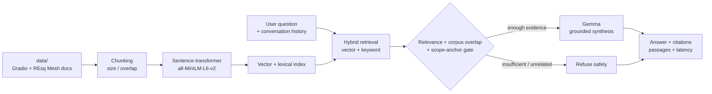
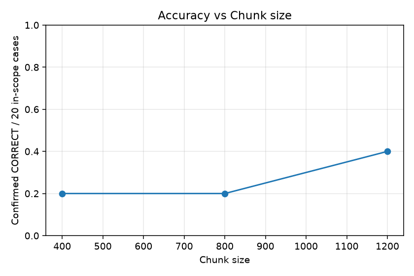
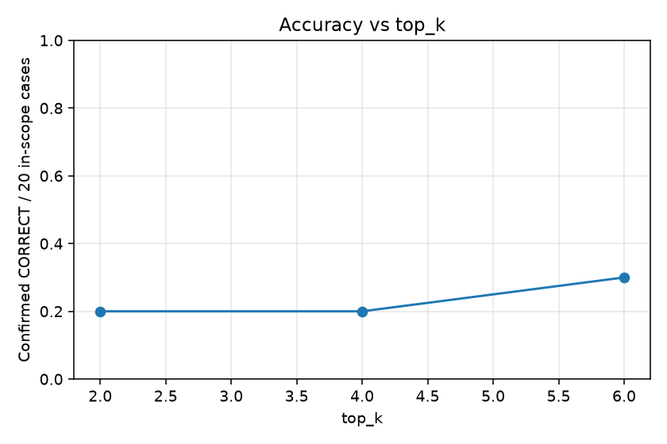

# Open-Source Contributor Guide

RAG Application with Gemma — Problem 2B

This project turns contributor documentation into a grounded question-answering guide. It combines Gradio's contributor docs with the REsq Mesh project README, retrieves relevant passages, answers with Gemma, and exposes the source files and passages used for each answer.

## Problem

New open-source contributors spend time searching across setup instructions, testing commands, pull-request conventions, community standards, and project-specific documentation. A generic chatbot can answer fluently while inventing a command or policy. This application is designed to answer only from the indexed guide and to refuse unrelated questions.

## Architecture



The evaluation track is intentionally separate from `rag.py` and `app.py`, which are owned by Laptop A. `eval/stub_rag.py` is not used for any reported live measurement; audit files identify production imports and input hashes.

## Pipeline

1. `build_index()` reads the documents under `data/`, splits them into overlapping chunks, and builds the retrieval structures.
2. A question is searched with hybrid lexical and embedding retrieval.
3. Similarity threshold, corpus vocabulary overlap and a scope-anchor check decide whether the application attempts generation.
4. Gemma receives the question and retrieved passages; it is instructed to stay within those passages.
5. The response includes `answer`, source file/chunk citations, passages with scores, `refused`, and `latency_s`.
6. `eval/run_eval.py` measures answer correctness with a Gemma judge, source citation hit, refusal accuracy, and latency.

## Design decisions and evidence

These are observations on the fixed 20-answerable/5-refusal set, not held-out tuning results. Defaults came from the application interface and were not selected to fit the questions.

| Factor | Observed confirmed-CORRECT rate, denominator 20 |
|---|---|
| Chunk size 400 / 800 / 1200 | 20.0% / 20.0% / 40.0% |
| top_k 2 / 4 / 6 | 20.0% / 20.0% / 30.0% |
| Hybrid on / off | 20.0% / 25.0% |
| Threshold .20 / .30 / .40 | 20.0% / 20.0% / 25.0% |

The highest observed rate was 40.0% (chunk_size=1200). This single stochastic OFAT sweep cannot establish optimal parameters or interactions. One answer changes accuracy by five percentage points. Keep the comparison exploratory and validate any configuration choice on a new holdout.

Hybrid combines normalized dense similarity (weight .75) and BM25 (weight .25). OFAT changes one factor around chunk_size=800, overlap=120, top_k=4, hybrid=true, threshold=.30. The default anchor reuses the audited paired RAG arm if raw metadata records reused_from; it is not an extra independent replicate.

Threshold diagnostics: .20 returned exactly the default passages for all 20 in-scope questions, but seven grades changed; .40 retained identical contexts for 19/20 questions, with six changed grades among those. These differences expose run variability and judge limitations, not clear threshold benefits.

Most urgently, 15/20 paired RAG answers returned SDK-object dumps marked MAX_TOKENS. Fix final-response extraction, output budgeting and JSON validation before interpreting small retrieval-parameter differences. File-level citation hits do not establish that a final answer is usable or supported.

See [full experiments](eval/results/experiments.md) for latency, citation rates, judgment coverage and raw rows.





## Run it

The production application is at the repository root. From that directory:

```bash
python -m venv .venv
# Windows PowerShell: .venv\Scripts\Activate.ps1
# macOS/Linux: source .venv/bin/activate
python -m pip install -r requirements.txt
python app.py
```

Put GOOGLE_API_KEY in an ignored local .env or the environment. Never print or commit it. This evaluation laptop used its own key and loaded it with python-dotenv.

```bash
python eval/run_eval.py --run-name baseline_v2
python eval/rag_vs_norag.py --sleep 2
python eval/experiments.py --sleep 2
python eval/failure_analysis.py
# Optional original two-model harness:
python eval/model_comparison.py --sleep 2
```

The published sweep reused its previously audited default arm to save calls, as recorded in raw JSON. The standard commands above remeasure it. Preserve baseline.json as the original v1 run; use a new run name for another baseline. The failure report includes completed production arms and excludes reused rows; use --baseline-only to restrict it.

Transient service/rate-limit failures use backoff and pacing. Judge v2 uses Gemma 26B, minimal thinking, temperature 0, 512 output tokens and a 45-second request timeout. Application generation settings are unchanged. Do not run the stub or --no-judge and present it as model quality. Runtime versions and model-selection audits are saved beside the reports.

## Evaluation results

All rows below are real production-path observations. Confirmed accuracy is CORRECT/20 and keeps unavailable judgments in the denominator; judgment coverage is shown separately.

| Run | Correct / partial / wrong | Judged | Confirmed accuracy /20 | Citation file hit | OOS refusal | Mean latency s |
|---|---:|---:|---:|---:|---:|---:|
| Original default baseline, judge v1 | 5 / 4 / 4 | 13/20 | 25.0% | 100.0% | 100.0% | 68.42 |
| Paired RAG, judge v2 | 4 / 1 / 15 | 20/20 | 20.0% | 100.0% | 100.0% | 10.33 |
| Paired no-RAG, judge v2 | 0 / 0 / 20 | 20/20 | 0.0% | 0.0% | 100.0% | 9.66 |

The original baseline has 7 unavailable judgments. Its successfully judged accuracy is 38.5% (5/13), not an all-20 accuracy. A 1488.34-second outage-affected call inflates its mean to 68.42s; median is 12.52s. Answer latency excludes judge calls, index building and deliberate sleeps.

Baseline v1 used the original judge settings; subsequent paired/OFAT runs use judge v2. Do not attribute cross-protocol differences solely to RAG or parameter settings. Within each paired/OFAT comparison, inputs and judge settings are held fixed and hashed.

No-RAG falsely refused 20/20 in-scope questions. Its prompt still requires evidence from passages even with retrieval disabled, so this is an ablation of the implemented path, not an unrestricted pretrained-model baseline. No confident wrong factual no-RAG examples were observed; the three side-by-side examples show the actual behavior.

The paired RAG run has 15/20 SDK-object dumps. Judge-CORRECT rows requiring output-format review: q04. Semantic grading alone does not certify UI-ready output.

- [Baseline and outage details](eval/results/baseline.md)
- [RAG versus no-RAG and three examples](eval/results/rag_vs_norag.md)
- [OFAT table and charts](eval/results/experiments.md)
- [Every classified failure with counts and fixes](eval/results/failure_analysis.md)
- [Output-format diagnostics and application-owner fixes](eval/results/output_format_diagnostics.md)
- [Optional model-comparison status/results](eval/results/model_comparison.md)
- [Protocol, provenance and limitations](EVAL_NOTES.md)

## Grounded contributor checklist

For a first Gradio contribution, the guide says to start by filing a clear, detailed, reproducible issue when outside pull requests are paused. Include the expected and actual behavior, numbered reproduction steps, a minimal reproduction, environment details, and relevant screenshots or tracebacks. For maintainer PR work, target `main`, keep initial CI passing, and run the backend formatter before pushing.

For REsq Mesh, remember that it is a research/demo system, not a medical device. Its README documents offline-first operation, source labels for AI plans, HMAC-SHA256 case-capsule verification, and rule-based fallback behavior.

## Limitations

- Twenty answerable cases and five refusal cases are a small, hand-grounded sample; two cases cover REsq Mesh. The source facts and questions were not changed after observing quality.
- The same Gemma family judges answers; this can miss response-format failures and produce false positives or false negatives. Short ground truths can omit valid source-supported alternatives. Inspect raw outputs and use independent/human review.
- SDK dumps and truncated JSON are observed application failures. The MAX_TOKENS marker indicates incomplete generations; returning an SDK repr is not a usable answer.
- Hosted generation depends on network and service availability. Outage latency is not a normal serving benchmark, and API errors must not be relabeled as retrieval-threshold problems.
- Source-file hit measures membership in returned sources, not claim-level entailment or exact passage support.
- No-RAG retains the evidence-only instruction; refusal behavior confounds any claim about an unrestricted model's memorized knowledge.
- OFAT does not test interactions; stochastic generation and a single pass limit parameter-selection claims.
- Questions run independently with history=None. Follow-up conversation memory and prompt-injection resistance are not evaluated by this set.
- Failure categories are provisional diagnostics. Repeated configuration-question observations are not additional independent test questions.
- REsq Mesh is documentation context, not medical advice. The contributor guide itself requires hosted Gemma access.

## Files

- [`eval/test_set.json`](eval/test_set.json) — grounded test cases.
- [`eval/run_eval.py`](eval/run_eval.py) — correctness, citations, refusals, and latency.
- [`eval/experiments.py`](eval/experiments.py) — one-factor parameter experiments and charts.
- [`eval/rag_vs_norag.py`](eval/rag_vs_norag.py) — paired RAG comparison.
- [`eval/failure_analysis.py`](eval/failure_analysis.py) — failure categories and fixes.
- [`PITCH.md`](PITCH.md) — five-minute demo script and judge Q&A.
