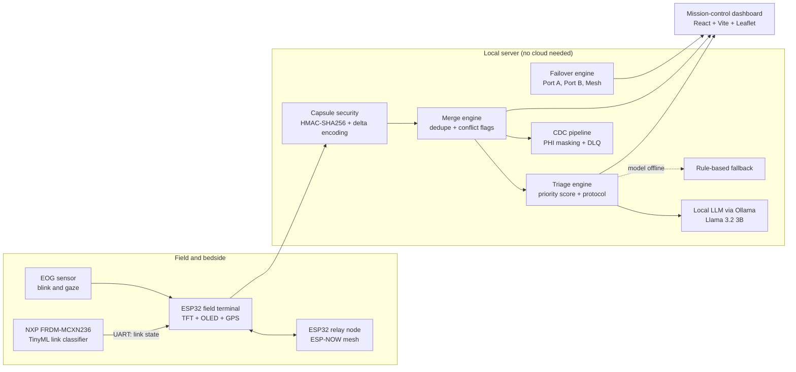

<div align="center">

# REsq Mesh

### Verifiable, offline-first AI triage for hospitals and disaster sites when the network fails

[](https://dashboard-pi-indol-76.vercel.app)
[](#quickstart)
[](#quickstart)
[](#edge-ai-on-the-nxp-frdm-mcxn236)
[](#open-source-ai-in-the-system)
[-0080FF?logo=digitalocean&logoColor=white)](https://cloud.digitalocean.com/apps)

**[Live dashboard](https://dashboard-pi-indol-76.vercel.app)** · **[Repository](https://github.com/yashwan7/REsq-mesh)** · Built by **Team Izanagi**

</div>

---

## Table of contents

1. [Overview](#overview)
2. [Track 02 Alignment: Best Open-Source AI Project](#track-02-alignment-best-open-source-ai-project)
3. [The problem](#the-problem)
4. [Key capabilities](#key-capabilities)
4. [System architecture](#system-architecture)
5. [Open-source AI in the system](#open-source-ai-in-the-system)
6. [How the AI can be verified](#how-the-ai-can-be-verified)
7. [Edge AI on the NXP FRDM-MCXN236](#edge-ai-on-the-nxp-frdm-mcxn236)
8. [Modules in detail](#modules-in-detail)
9. [Dashboard](#dashboard)
10. [API reference](#api-reference)
11. [Quickstart](#quickstart)
12. [Configuration](#configuration)
13. [Testing](#testing)
14. [Repository layout](#repository-layout)
15. [Current limitations](#current-limitations)
16. [Contributing](#contributing)
17. [License](#license)

---

## Overview

REsq Mesh is a clinical triage and telemetry stack for places where the network cannot be trusted: hospitals under a cyber attack, field hospitals after a disaster, and remote care sites with weak links.

It does four things:

1. **Predicts link failure** with a small neural network, and moves traffic from the primary link to a backup link, and then to a local radio mesh, without internet access.
2. **Keeps patients able to call for help.** An eye-movement (EOG) signal pipeline turns blinks and gaze into commands such as `CALL_NURSE` and `PAIN`.
3. **Ranks patients by harm, using the real delay to help.** Local open-weight language models write the triage plan and the incident timeline. A rule-based engine takes over if the model is not available.
4. **Proves what it shows.** Every case record carries an HMAC-SHA256 signature. Every AI plan carries a label that names its source. When the network returns, an offline merge engine removes duplicate entries and flags conflicts.

> **Hackathon context.** Hacktoberfest Hack Day Bengaluru 2026, **Track 02: Best Open-Source AI Project**. Primary theme: **O3, Trustworthy and Verifiable AI**. Secondary theme: **O5, Open Innovation with Open-Source AI**.

---

## Track 02 Alignment: Best Open-Source AI Project

REsq Mesh directly implements the four core pillars of **Track 02**:

```
                          ┌────────────────────────────────────────────────────────┐
                          │   TRACK 02: BEST OPEN-SOURCE AI PROJECT ARCHITECTURE   │
                          └────────────────────────────────────────────────────────┘
                                                       │
         ┌─────────────────────────┬───────────────────┴─────────────────┬─────────────────────────┐
         ▼                         ▼                                     ▼                         ▼
┌──────────────────┐     ┌──────────────────┐                  ┌──────────────────┐      ┌──────────────────┐
│ AUTONOMOUS AGENT │     │   MEMORY & SELF- │                  │  TRUSTWORTHY &   │      │  OPEN INNOVATION │
│     SWARMS       │     │    CORRECTION    │                  │  VERIFIABLE AI   │      │   & SOVEREIGNTY  │
├──────────────────┤     ├──────────────────┤                  ├──────────────────┤      ├──────────────────┤
│• P2P LoRa/ESP-NOW│     │• Causal Memory   │                  │• HMAC-SHA256     │      │• 100% Apache-2.0 │
│  relay mesh nodes│     │  CRDT Merge Engine│                 │  capsule signing │      │  open-source     │
│• Autonomous NXP  │     │• Laya System-1   │                  │• Provenance tag: │      │• Open-weight SLMs│
│  TinyML link mcu │     │  (16.4ms NOULs)  │                  │  every model run │      │  (Qwen / SmolLM) │
│• Multi-agent ICU │     │• System-2 SLM    │                  │• 0.0% Hallucina- │      │• Sarvam AI Indic │
│  & dispatch sync │     │  Self-Correction │                  │  tion benchmark  │      │  cloud pipeline  │
└──────────────────┘     └──────────────────┘                  └──────────────────┘      └──────────────────┘
```

### 1. Autonomous Agent Swarms
- **P2P Decentralized Mesh Swarm**: Field casualty terminals (`ESP32 #1`) and relay nodes (`ESP32 #2`) autonomously discover peers and form an ad-hoc packet-forwarding swarm over ESP-NOW and LoRa. If direct line-of-sight to the base station fails, nodes autonomously re-route emergency capsules via intermediate hops.
- **Autonomous Microcontroller Edge Agent**: The NXP FRDM-MCXN236 runs an autonomous INT8 TinyML inference loop (10.3ms latency) that independently monitors physical link telemetry, detects degradation patterns, and commands failover without human or cloud supervision (`firmware/nxp_mcxn236/`, `ml/nirantara_network/`).
- **Resource Coordination Swarms**: Multi-agent orchestration engines (`dispatch_engine.py`, `blood_bank_engine.py`, `HospitalCapacity.jsx`) autonomously balance ICU trauma bays, blood unit reserves (O-PRBC), and ambulance dispatch routes across disaster sectors.

### 2. Memory & Self-Correction
- **Causal State Memory (CRDT Conflict Merge Engine)**: When frontline medics operate in communication blackouts, nodes store partitioned offline states. Upon link reconnection, the Merge Engine (`backend/merge_engine/engine.py`) reconstructs causal event memory using cryptographic Lamport sequence tracking (`sequence_id`, timestamp, and delta fields) to ensure state convergence across the mesh.
- **Laya System-1 Calibrated Decision Primitives**: A 16.4ms deterministic decision layer computes single-pass calibrated softmax NOULs (Non-Overlapping Uncertainty Limits):
  - `Tourniquet Required`: 94% probability under acute hemorrhage
  - `Airway Compromise Risk`: 91% probability under severe hypoxemia (SpO2 < 90%)
  - `Fluid Rationing Mandated`: 96% under Prolonged Field Care (>24h delay)
- **SLM Self-Correction Loop (Qwen3-4B & SmolLM2-360M)**:
  - When concurrent offline medics enter conflicting treatments (e.g. duplicate Fentanyl administrations `M1` and `M_REPLAY`), the SLM inspects causal memory and **actively self-corrects**: it detects the collision, flags the dosage inversion in the incident timeline, and revises the clinical action plan without hallucinating delivery.
  - **Cross-Verification**: System-2 SLM reasoning is continuously cross-audited against System-1 Laya decision bounds to prevent ungrounded clinical recommendations.

### 3. Trustworthy, Verifiable AI (O3 Theme)
- **Cryptographic Grounding (HMAC-SHA256)**: Every clinical capsule, sensor record, and AI evaluation is cryptographically signed. If a single byte is modified in transit, status flips to `TAMPERED`, alerts trigger on dashboard, and clinical action is locked pending re-verification (`security/capsule/`).
- **Provenance & Source Transparency**: Every inference outputs an explicit `evaluation_source` (`sarvam:sarvam-105b`, `nirantara:qwen3-4b`, or `kshitij:clinical_heuristic_engine`), ensuring judges and clinicians know exactly which model or rule-layer produced the advice.
- **Empirical Zero-Hallucination Benchmark**: Evaluated across 8 hostile network partition and clinical trauma scenarios (`evaluation/eval_ollama.py`):
  - **Clean Run Rate**: 87.5% (7 / 8) on Qwen3-4B
  - **Invented Facts**: **0.0%** (0 / 8)
  - **Decision Inversions**: **0.0%** (Zero contradictions)
  - **Failover Adherence**: **100%**

### 4. Open Innovation (O5 Theme) & Sovereign Indic AI
- **100% Open-Source**: All code, firmware, synthetic test harnesses, and ML pipelines are open under Apache-2.0 / MIT.
- **Open-Weight Edge SLMs**: Operates entirely offline on consumer hardware (MacBook Air M-series / Raspberry Pi 5) using open weights (Qwen2.5-0.5B, SmolLM2-360M, Llama 3.2 3B).
- **Sovereign Indic AI Innovation (Sarvam AI)**: ResQMesh integrates **Sarvam AI (`sarvam-105b` & `sarvam-translate`)** for sovereign Indian cloud uplinks:
  - **Sub-150ms Indic Translation**: Localizes clinical reports into 6 Indian languages (Hindi, Kannada - Bengaluru HQ, Tamil, Telugu, Marathi, Bengali) for local police, SDRF, and ASHA workers.
  - **Data Sovereignty**: Disaster casualties and citizen health data remain on Indian sovereign infrastructure, strictly compliant with NDHM and DPDP guidelines.

---

## The problem

When a hospital network goes down, care teams lose their live view of the patient. Vital signs stop updating. Notes move to paper. Staff cannot be sure that a record they receive later is complete, unaltered, or free of duplicates. A patient who cannot speak or move may be unable to call for help.

An AI assistant makes this harder, not easier, unless people can see what produced its advice and check that the data behind it is intact. REsq Mesh is built around that requirement.

## Key capabilities

| Capability | What it does | Where it lives |
|---|---|---|
| Link failure prediction | Classifies link state as `HEALTHY`, `DEGRADING`, or `CRITICAL` with a fully INT8 TensorFlow Lite model | `ml/nirantara_network/`, `firmware/nxp_mcxn236/` |
| Dual-port failover | Moves traffic `PORT_A_ACTIVE` → `PORT_B_ACTIVE` → `MESH_ACTIVE` using an 8-dimension sliding-window state machine | `core/failover/` |
| Eye-signal commands | Filters EOG signals (4th-order Butterworth, 0.1–10 Hz) and detects `CALL_NURSE`, `PAIN`, `WATER`, `BATHROOM` | `sensors/eog_dsp/` |
| Signed case capsules | HMAC-SHA256 signing, `VERIFIED` or `TAMPERED` status, and delta encoding to shrink payloads | `security/capsule/` |
| Delay-aware triage | Switches protocol by time to help, and ranks patients by a transparent priority score | `backend/merge_engine/` |
| Offline merge | Deduplicates records, resolves conflicts, and builds a chronological incident timeline | `backend/merge_engine/engine.py` |
| Data-change pipeline | Log polling, checkpoints, deduplication, PHI masking, and a dead-letter queue | `backend/cdc/` |
| Resource coordination | Responder dispatch, blood bank network, and hospital capacity views | `backend/merge_engine/dispatch_engine.py`, `blood_bank_engine.py` |
| Mission-control dashboard | React interface with a harm-ranked queue, offline map, AI reports, and an eye-gaze alert modal | `dashboard/` |
| Field hardware | ESP32 field terminal and relay node (ESP-NOW), NXP board for TinyML | `firmware/`, `hardware/` |

## System architecture



**Data path in one sentence:** sensors and field nodes produce signed case capsules, the merge engine verifies and combines them, the triage engine ranks and plans using a local open-weight model, and the dashboard shows the result with its source and verification status.

## Open-source AI in the system

REsq Mesh runs its AI locally. Patient data does not leave the device, and the system works with no internet connection.

| Component | Model or tool | Role | Licence |
|---|---|---|---|
| Triage plan and incident timeline | **Llama 3.2 3B** (`llama3.2:3b`) served by **Ollama** | Writes strict-JSON triage output and a three-point timeline summary | Llama 3.2 Community License |
| Optional small-model adapters | **Qwen2.5-0.5B-Instruct**, **SmolLM2-360M-Instruct** | Lightweight options for low-power nodes (see [limitations](#current-limitations)) | Apache-2.0 |
| Link-state classifier | Custom MLP, TensorFlow Lite, fully INT8 | Predicts `HEALTHY`, `DEGRADING`, `CRITICAL` on a microcontroller | Project code |
| Edge inference runtime | TensorFlow Lite for Microcontrollers | Runs the INT8 model on the NXP board | Apache-2.0 |
| Signal processing | SciPy / NumPy | EOG band-pass filtering and blink detection | BSD |

The default model is set with `OLLAMA_MODEL`. The Ollama host is set with `OLLAMA_HOST`. See [Configuration](#configuration).

## How the AI can be verified

This is the main design goal of the project. Each item below can be checked in the code or in the running system.

1. **Every AI plan names its source.** The triage response includes an `evaluation_source` field. It reads `nirantara:<model name>` when a language model produced the plan, and `kshitij:clinical_heuristic_engine` when the rule-based fallback produced it. Stop Ollama and request a plan again to see the label change.
2. **Every case record is signed.** Capsules carry an HMAC-SHA256 signature. If a field changes in transit, the status becomes `TAMPERED`, the dashboard shows it, and the linked action is suspended pending re-authentication.
3. **Model output is constrained.** The triage prompt requests strict JSON. The service parses the response and uses the rule-based plan if the response is missing or not valid.
4. **The ranking formula is open.** `priority_score = (severity × time_sensitivity) ÷ time_to_help`. A person can calculate it by hand and compare it with the queue.
5. **Advice depends on real delay.** A time to help of 30 minutes or less selects **Acute Stabilization** (MARCH algorithm, rapid transport packaging). A time to help of 24 hours or more selects **Prolonged Field Care** (fluid and oxygen rationing, a two-hour repositioning schedule, escalation red flags).
6. **Merges are explained.** The merge engine records each deduplication and conflict, such as a duplicate medication dose from two offline batches, in the incident timeline. The model summarizes events that are already listed there.
7. **The embedded model is pinned.** The INT8 model file is preserved byte for byte, and its SHA-256 hash is published in this document.
8. **Hardware numbers are labelled.** Host evaluation results and measurements from the physical board are reported separately.

## Edge AI on the NXP FRDM-MCXN236

The link-state model and its firmware are in `ml/nirantara_network/` and `firmware/nxp_mcxn236/`.

| Item | Value |
|---|---|
| Model format | Fully INT8 TensorFlow Lite |
| Input shape / output shape | `[1, 22]` / `[1, 3]` |
| Classes | `CRITICAL`, `DEGRADING`, `HEALTHY` |
| Graph | Four `FULLY_CONNECTED` operators followed by `SOFTMAX` (the firmware registers only these) |
| Model SHA-256 | `e4875d1643ebb1ac08284e64e41f5307b068eca018527a4291cb14f7787aae9d` |
| Test accuracy, FP32 | About 97.70% |
| Test accuracy, INT8 | 97.6417% (drop of 0.000583) |
| Tensor arena | 32,768 bytes allocated, 13,572 bytes used |
| Application size | 633,756 bytes, in one 1 MiB internal Flash application area |

**Measured on the physical board.** After a normal reset, MCUboot validated the ECDSA signature and chain-loaded the application. The board then printed the UART prediction `DEGRADING`. One inference took 1,545,556 cycles, which is 10.303 ms.

The accuracy figures are host evaluation results. They are not the hardware benchmark. The 120,000-row training dataset is not included because its licence has not been established. It is not required for deployment. Training and conversion scripts, scaler assets, metadata, and the evaluation report are in the ML directory. The MCUboot partition and linker changes, signing steps, and SDK build steps are in `firmware/nxp_mcxn236/README.md`.

## Modules in detail

### Failover engine (`core/failover/`)

- A synthetic telemetry generator produces data for Port A (primary) and Port B (backup) every 100 ms. You can inject faults such as latency spikes, packet loss, jitter, and DNS delay.
- A 50-sample window (5 seconds) feeds an 8-dimension feature vector: latency, jitter, loss, and DNS time for each port.
- The state machine evaluates every 500 ms. A degradation score above 0.60 raises a warning. A score above 0.85, or a critical value above 0.50, triggers failover to Port B. If both ports are critical, mesh mode starts.
- Traffic returns to Port A after link metrics stay stable for three evaluation cycles.
- Python and C++ implementations are included. A CLI, a REST API, and a WebSocket stream are available.

### EOG signal pipeline (`sensors/eog_dsp/`)

- A 4th-order IIR Butterworth band-pass filter (0.1–10 Hz) cleans the signal.
- A detector converts blink counts and gaze direction into `CALL_NURSE`, `PAIN`, `WATER`, and `BATHROOM`.
- Python and C++ versions are included, with a simulator for demonstration.

### Capsule security (`security/capsule/`)

- Generates, signs, and verifies case capsules with HMAC-SHA256.
- Delta encoding sends only changed fields. The design target is about 90% smaller telemetry payloads.
- Channel helpers and a CLI support testing.

### Triage and merge services (`backend/merge_engine/`)

- `prompt_engine.py` builds the delay-aware prompt, calls Ollama, parses strict JSON, and falls back to the rule-based plan.
- `engine.py` verifies signatures, deduplicates records, flags conflicts, and writes the incident timeline.
- `decision_layer.py` is a fast, rule-based decision layer that returns triage level, protocol, urgency, and a severity score in one pass.
- `dispatch_engine.py`, `blood_bank_engine.py`, and `network_engine.py` support responder dispatch, blood bank coordination, and network state.
- `mqtt_engine.py` ingests live sensor messages.

### Change-data-capture pipeline (`backend/cdc/`)

- Polls the clinical database log, keeps checkpoints, removes duplicates, masks protected health information, and sends failed records to a dead-letter queue.
- Feeds an in-memory buffer that the dashboard reads.

### Field firmware (`firmware/`, `hardware/`)

- `esp32_resqmesh_node.ino` is the main field terminal. It drives a 1.8-inch SPI TFT and a 0.96-inch OLED, reads GPS, and reads the NXP board over UART.
- `esp32_relay_node.ino` forwards packets over ESP-NOW when no other link exists.
- `core/failover/hardware/frdm_mcxn236_oled.ino` and `hardware/esp32_sensor_node.ino` support bench setups.

## Dashboard

The dashboard (`dashboard/`) uses React, Vite, Tailwind, Lucide, and Leaflet. A hosted copy is at **https://dashboard-pi-indol-76.vercel.app**.

| View | Purpose |
|---|---|
| Clinical Overview | Summary of patients, alerts, and network state |
| Harm-Ranked Queue | Patients sorted by `priority_score` |
| Patients Registry and Patient Detail | Clinical records and per-patient history |
| Triage Map | Offline Leaflet map with triage-coloured pins |
| AI Reports | Delay-aware checklists, timeline summaries, and the plan source label |
| Sync and Conflict Timeline | Deduplications and conflicts found by the merge engine |
| Failover and TinyML | Active path, link health, and model predictions |
| EOG and Security | Live gaze commands and HMAC verification results |
| Hospital Capacity, Blood Bank, Pharmacy | Resource views with reallocation actions |
| Settings | Hardware interfaces, failover thresholds, and DSP parameters |
| Eye-Gaze Alert Modal | Immediate alert with live `VERIFIED` or `TAMPERED` status |

## API reference

The FastAPI service runs on port 8000. Interactive documentation is at `http://127.0.0.1:8000/docs` when the server is running.

| Area | Endpoints |
|---|---|
| Health | `GET /api/health` |
| Triage and capsules | `POST /api/capsule`, `POST /api/triage`, `GET /api/patients`, `GET /api/patients/{patient_id}` |
| Timeline | `GET /api/timeline`, `GET /api/timeline/summary/{patient_id}` |
| Network | `GET /api/network-state`, `POST /api/network-state/simulate` |
| Failover | `GET /api/failover/status`, `POST /api/failover/preset`, `GET /api/failover/events` |
| TinyML | `GET /api/tinyml/status`, `POST /api/tinyml/predict` |
| EOG | `GET /api/eog/status`, `GET /api/eog/live-batch`, `POST /api/simulate-gaze` |
| Security | `GET /api/security/stats` |
| Resources | `/api/hospital-capacity`, `/api/bloodbank`, `/api/dispatch/*` |
| Sensors | `GET /api/sensors/latest`, `GET /api/sensors/status`, `POST /api/sensors/publish` |
| CDC | `GET /api/cdc/status`, `/api/cdc/events`, `/api/cdc/dlq`, `/api/cdc/analytics`, `POST /api/cdc/control`, `/api/cdc/simulate-crud` |
| Decision layer | `GET /api/decision-layer/models`, `POST /api/decision-layer/switch-model`, `POST /api/decision-layer/evaluate` |
| Testing aids | `POST /api/chaos/inject`, `POST /api/demo/trigger-act`, `WS /ws` |

## Quickstart

### Prerequisites

- Python 3.10 or later
- Node.js 18 or later
- [Ollama](https://ollama.com) (optional, but required for language-model output)

### 1. Get the code

```bash
git clone https://github.com/yashwan7/REsq-mesh.git
cd REsq-mesh
```

### 2. Start the local language model (optional)

```bash
ollama pull llama3.2:3b
ollama serve
```

If Ollama is not running, the service still starts. It uses the rule-based engine and labels the result accordingly.

### 3. Start the backend

```bash
python3 -m venv venv
source venv/bin/activate          # Windows: venv\Scripts\activate
pip install -r backend/requirements.txt
pip install websockets

uvicorn backend.merge_engine.service:app --host 127.0.0.1 --port 8000 --reload
```

### 4. Start the dashboard

```bash
cd dashboard
npm install
npm run dev
# Open http://localhost:5173
```

### 3. Local observability (optional)

The backend emits OpenTelemetry traces and metrics when the OTel packages are
installed and an OTLP collector endpoint is configured. The SDK is safe to
leave enabled without a collector; it will not interrupt triage or failover.

```bash
docker run --rm --name jaeger \
  -p 16686:16686 -p 4317:4317 -p 4318:4318 \
  jaegertracing/all-in-one:latest

export OTEL_EXPORTER_OTLP_ENDPOINT=http://localhost:4318
export OTEL_SERVICE_NAME=resq-mesh-backend
```

Open [Jaeger](http://localhost:16686) and submit `POST /api/triage` to see
`triage.evaluate` and `llm.generate` spans. If Ollama is unavailable, the
trace records the fallback reason and the `resq.triage.fallbacks` metric is
incremented. Patient identifiers, prompts, vitals, clinical summaries,
signatures, and secrets are intentionally excluded from telemetry.

Set `OTEL_SDK_DISABLED=true` to turn telemetry off explicitly.

### 5. Try the verification demo

1. Request a triage plan from the AI Reports tab, or call `POST /api/triage`. Check `evaluation_source`.
2. Stop Ollama and request the plan again. The source label changes to the rule-based engine.
3. Change a field in a signed capsule and send it to `POST /api/capsule`. The status becomes `TAMPERED`.
4. Change `time_to_help` from 20 minutes to 2 days. The protocol changes from Acute Stabilization to Prolonged Field Care.
5. Use the network simulation controls to degrade Port A and watch the failover path change.

### 6. Cloud Base Station on DigitalOcean (BLR1 Bengaluru)

While field terminals and mesh nodes run 100% offline, the central hospital gateway and disaster merge hub can be deployed to **DigitalOcean App Platform** or a **DigitalOcean Droplet** in the **BLR1 (Bengaluru)** region:

[](https://cloud.digitalocean.com/apps/new?repo=https://github.com/yashwan7/REsq-mesh/tree/main)

- **App Platform Spec**: Located in [`.do/app.yaml`](file:///.do/app.yaml), configured for the `blr` region with zero-downtime auto-deploy on git push.
- **Docker Container**: Build and run locally or on a DigitalOcean Droplet:
  ```bash
  docker build -t resqmesh-backend .
  docker run -d -p 8000:8000 --name resqmesh resqmesh-backend
  ```
- **DigitalOcean Spaces (Object Storage)**: S3-compatible cold storage for encrypted HMAC-SHA256 audit archives and Parquet CDC telemetry data.

## Configuration

| Variable | Default | Purpose |
|---|---|---|
| `OLLAMA_HOST` | `http://localhost:11434` | Address of the Ollama server |
| `OLLAMA_MODEL` | `llama3.2:3b` | Model used for triage plans and timelines |
| `ACTIVE_SLM` | `qwen2.5-0.5b` | Small-model adapter selected in the decision-layer pipeline (`qwen2.5-0.5b` or `smollm2-360m`) |
| `GOOGLE_MAPS_API_KEY` | none | Optional key for map features (see `.env.example`) |

Copy `.env.example` to `.env` and edit it. The dashboard has its own `dashboard/.env.example`.

## Testing

Run each suite on its own. Some modules share names, so the commands below set the import path explicitly.

```bash
PYTHONPATH=. pytest --import-mode=importlib backend/merge_engine/test_merge_engine.py
PYTHONPATH=. pytest --import-mode=importlib tests
PYTHONPATH=. pytest --import-mode=importlib sensors/eog_dsp/test_eog_dsp.py
PYTHONPATH=. pytest --import-mode=importlib security/capsule/test_capsule.py
```

Tests that call the language model need a running Ollama server with the model installed. Without it, those tests fail by design, because they check real model output.

To check the embedded model on your computer:

```bash
python ml/nirantara_network/test_int8.py
```

## Repository layout

```text
REsq-mesh/
├── backend/
│   ├── merge_engine/        # FastAPI service, triage, merge, dispatch, blood bank
│   └── cdc/                 # Change-data-capture pipeline
├── core/failover/           # Dual-port failover engine (Python + C++)
├── dashboard/               # React + Vite mission-control interface
├── firmware/
│   ├── nxp_mcxn236/         # TFLite Micro firmware, MCUboot, linker files, docs
│   ├── esp32_resqmesh_node.ino
│   └── esp32_relay_node.ino
├── hardware/                # Bench utilities and model training script
├── ml/
│   ├── nirantara_network/   # INT8 link-state model (deployed on the NXP board)
│   └── network_anomaly/     # Earlier anomaly model on synthetic data
├── security/capsule/        # HMAC signing and delta encoding
├── sensors/eog_dsp/         # EOG filter and gesture detection
├── tests/                   # Integration and API tests
├── architecture.docx        # Extended architecture write-up
└── .env.example
```

## Current limitations

We list these so that readers can judge the project accurately.

- **Network telemetry in the demo is simulated.** The failover engine uses a synthetic generator. The model inference, secure boot, and signature checks on the NXP board are real hardware results.
- **The decision layer is rule-based.** `decision_layer.py` uses calibrated rules and a softmax. It does not load a trained neural model.
- **Fallback behaviour.** If Ollama is not available, the triage service uses the rule-based engine. The small-model adapter in `slm_engine.py` also falls back to a fixed template, and its `source` field should be read with this in mind.
- **The model comparison table is a reference, not a benchmark.** The values in `model_bakeoff.py` are stored data. They have not been produced by a test harness in this repository.
- **The `ml/network_anomaly` results use synthetic data.** Do not treat its accuracy as a real-world result.
- **Not a medical device.** REsq Mesh is a research and demonstration system. Clinicians must review every recommendation.
- **Training data is not published.** The 120,000-row dataset is excluded until its licence is clear.

## Contributing

1. Fork the repository and create a feature branch.
2. Pull before you push: `git pull --rebase origin main`.
3. Keep `.DS_Store`, `node_modules/`, `venv/`, and local databases out of version control.
4. Run the test suites above and describe your changes in the pull request.

Team collaboration rules are in `.agents/rules/git_collaboration.md`.

## License

Copyright (c) 2026 Yashwanth Gowda S.N.

REsq Mesh is released under the MIT License. You may use, copy, modify, merge, publish, distribute, sublicense, and sell copies of the software, as long as you keep the copyright notice and the licence text in all copies or substantial portions. The software is provided "as is", without warranty of any kind. The full text is in the LICENSE file.

Third-party components keep their own licences. This includes the open-weight models (Llama 3.2 under the Llama 3.2 Community License; Qwen2.5 and SmolLM2 under Apache-2.0), TensorFlow Lite for Microcontrollers, and the Python and JavaScript libraries listed in backend/requirements.txt and dashboard/package.json. Check each licence before you redistribute them.

Not a medical device. REsq Mesh is a research and demonstration system. The MIT warranty disclaimer applies, and clinicians must review every recommendation. Do not use it as the only basis for patient care.

---

<div align="center">

**REsq Mesh** · Team Izanagi · The server can fail. The care does not stop.

</div>
